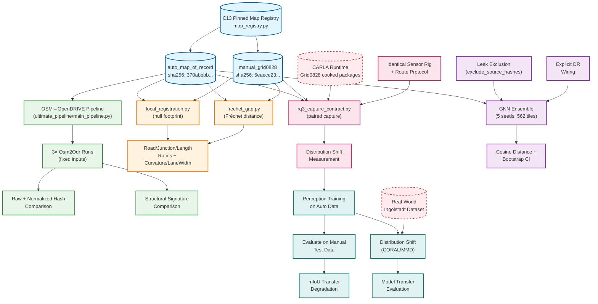

# Thesis Closure Dependency DAG

**Freeze Date**: 2026-10-11
**Production SHA**: `65eb0f14d226104692dd845f8a528759fbeb90c4` (integration/production-large-map-20260918)
**Consolidation SHA**: `b6a6726ae81c37d6c0613c319b12918bb99d4337` (consolidation)

---

## Dependency Graph



---

## Linear Dependency Chains

### RQ1 Chain (COMPLETE — AUTHORITATIVE)
```
C13 Registry → auto_map_of_record (pinned)
    → OSM→OpenDRIVE pipeline (fixed code @ 65eb0f14)
    → 3× repeated Osm2Odr runs (fixed inputs)
    → Raw hash comparison (NON-repeatable)
    → Normalized hash comparison (repeatable, timestamp source)
    → Structural signature comparison (REPEATABLE)
```

### RQ2 Chain (COMPLETE — BOUNDED)
```
C13 Registry → auto_map_of_record + manual_grid0828 (both pinned)
    → local_registration.py (hull-footprint crop, registry-resolved)
    → frechet_gap.py (registry-resolved)
    → Local ratios: road-length 2.683x, junction 3.782x, road-count 3.561x
    → Fréchet: mean 58.18m / median 36.13m / p90 140.48m (894 pairs)
    → Building density: hull gap 0.2308 (3,279/5,682 vs 993)
```

### RQ3 Chain (BLOCKED — DEFERRED_RUNTIME)
```
C13 Registry → auto_map_of_record + manual_grid0828 (both pinned)
    → rq3_capture_contract.py (frame/rig parity FIXED)
    → CARLA Runtime (Grid0828 cooked packages) ❌ BLOCKED
        → GPU driver adapter stall (nvwgf2umx.dll) — render path
        → -nullrhi busy-spin livelock — headless path
    → Identical sensor rig + route protocol
    → Paired perceptual capture
    → Distribution shift measurement
```

### RQ4 Chain (COMPLETE — AUTHORITATIVE)
```
C13 Registry → auto_map_of_record (pinned)
    → 5-seed GNN ensemble (seeds 42-46, 562 tiles, 50 epochs)
    → Leak exclusion mechanism (exclude_source_hashes) ACTIVE
    → Pre-training leakage audit: PASS
    → Post-hoc leakage audit (5 checkpoints): PASS
    → Explicit DR wiring: CONFIRMED
    → Cosine distance: 0.9207 (95% CI [0.845, 0.976]) — excludes zero
```

### RQ5A Chain (BLOCKED — DEFERRED_RUNTIME)
```
RQ3 paired datasets (auto + manual) ❌ BLOCKED (requires CARLA runtime)
    → Perception training on auto data
    → Evaluation on manual test data
    → mIoU transfer degradation measurement
```

### RQ5B Chain (BLOCKED — DEFERRED_EXTERNAL_DATA)
```
RQ5A trained model (or generated-only)
    → Real-world Ingolstadt dataset ❌ NOT AVAILABLE
    → Distribution shift (CORAL/MMD)
    → Model transfer evaluation
```

---

## Cross-RQ Dependencies

| Dependency | Status | Notes |
|------------|--------|-------|
| RQ1 → RQ2 | SATISFIED | RQ1's structural stability underpins RQ2's map comparison validity |
| RQ1 → RQ4 | SATISFIED | RQ1's variability bounds contextualize RQ4's natural variability |
| RQ2 → RQ3 | SATISFIED (code) | RQ2's structural gaps motivate RQ3; RQ3 code ready |
| RQ3 → RQ5A | BLOCKED | RQ5A requires RQ3 datasets |
| RQ5A → RQ5B | BLOCKED | RQ5B requires RQ5A model or generated-only baseline |

---

## External Dependencies (Outside Thesis Scope)

| Dependency | RQ Impact | Resolution Path |
|------------|-----------|-----------------|
| CARLA runtime on this GPU/driver | RQ3, RQ5A | Environment-level: different GPU, driver, or CARLA build |
| Real-world Ingolstadt dataset | RQ5B | Operator-supplied; not in repository control |
| UE4Editor.exe (Avast quarantine) | RQ3 cook path | AV exclusion or alternative build machine |

---

## Thesis-Blocking vs. Post-Thesis Classification

**Thesis-Blocking** (must resolve for thesis closure):
- RQ3 CARLA runtime hangs (prevents required execution — criterion 4)
- RQ5B real-world dataset absence (prevents required execution — criterion 4)

**Post-Thesis Tech Debt** (documented, not thesis-blocking):
- GAP-008: Dual geometry kernels (architectural, no RQ result change)
- GAP-017: Audio mixer probe (diagnostic, not a fix)
- GAP-018: UE4 engine build access (external org issue)
- GAP-038: Import contract wiring (scaffolding, not wired)
- GAP-048: 376 unresolved lane successors (partial, not tolerance-raised)
- GAP-055: CI WinDLL guards (COMPLETED, CI gate running)
- Lane-count classifier not wired to acceptance gate (follow-up)
- Tiling flag UP_ENABLE_ROAD_LINK_TARGET_REPAIR=1 edge case (flagged, default off)

---

## Provenance Chain (Map of Record)

```
auto_map_of_record promotions (newest → oldest):
370abbbb (2026-09-17) ← CURRENT PIN
  supersedes 2ca342d8 (2026-09-05 reproregen2)
    supersedes 847d41bd (2026-09-05 reproregen1)
      supersedes cb85fc14 (2026-09-05 round-6 elevation)
        supersedes 60a36325 (2026-09-04 round-5 hygiene)
          supersedes e281367e (2026-09-04 deep-audit)
            supersedes a5bd01be (2026-09-02 junctionfix)
              supersedes 744757f3 (2026-08-26 C29 building patch)
                supersedes 69b1f520 (pre-C29)

manual_grid0828: 5eaece23 (stable, Grid0821 byte-identical)
```

---

## Evidence Artifacts (Frozen)

| RQ | Artifact | Location |
|----|----------|----------|
| RQ1 | 3-run determinism evidence | `reports/post_audit_hardening/C15_RQ4_DR/` |
| RQ2 | Local registration (hull) | `reports/post_audit_hardening/C14_RQ1_STRUCTURAL_GAP/local_registration.json` |
| RQ2 | Fréchet distance | `reports/post_audit_hardening/C14_RQ1_STRUCTURAL_GAP/frechet_distance.json` |
| RQ3 | Paired capture contract | `ultimate_pipeline/perception/rq3_capture_contract.py` |
| RQ3 | RPC hang diagnostics | `reports/production_readiness/20260918T000000Z_PRODUCTION_CLOSURE/GAP017_GAP_COOK_STALL_DIAGNOSTICS_20261008.md` |
| RQ4 | Leak-free retrain | `reports/production_readiness/20260924T000000Z_GAP010_RQ4_LEAKFREE_RETRAIN/` |
| RQ4 | Leakage audits (pre/post) | Same directory: `PRE_TRAINING_LEAKAGE_AUDIT.json`, `POST_HOC_LEAKAGE_AUDIT.json` |
| RQ5 | Thesis contract boundaries | `research/thesis_rq_contract.yaml:86-88` |

---

**SCOPE_FREEZE = true**
No further scope expansion unless a newly discovered defect meets thesis-blocking criteria.